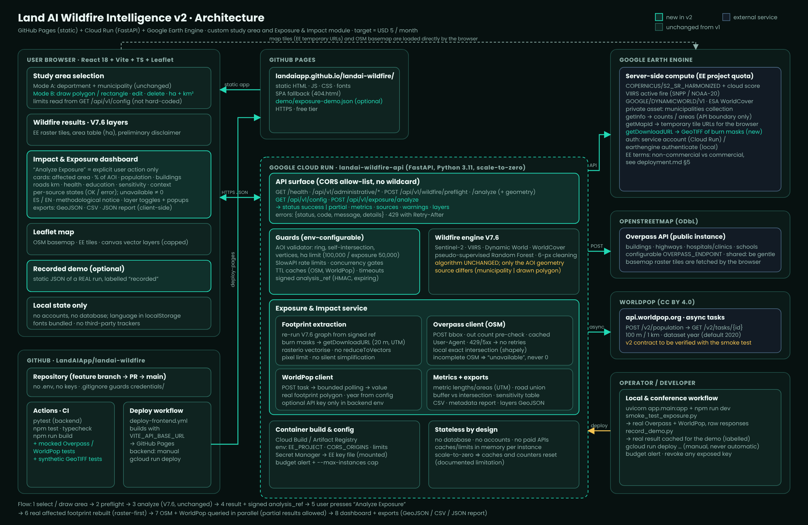

# Architecture (v2)

Editable vector version: [`img/architecture.svg`](img/architecture.svg).

* **Frontend** – static React/Vite/Leaflet app on GitHub Pages; reads limits from `GET /api/v1/config`; local state only.
* **Backend** – FastAPI on Cloud Run (scale-to-zero, no database). Guards: AOI validator, SlowAPI limits, concurrency gates, TTL caches, signed `analysis_ref`.
* **Earth Engine** – V7.6 compute (unchanged), tile URLs for the browser, `getDownloadURL` GeoTIFF for the footprint (new).
* **OSM (Overpass)** and **WorldPop** – called only from the backend, only after the explicit "Analyze Exposure" click.
* Flow: select/draw area → preflight → analyze (V7.6) → result + `analysis_ref` → user presses *Analyze Exposure* → footprint rebuilt → OSM + WorldPop → dashboard + exports.
